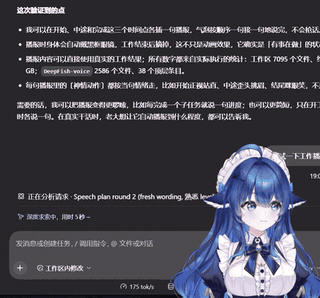

<h1 align="center">DeepFish 语音版：让 Agent 的桌宠开口说话</h1>

<p align="center">大肥鱼 Live2D 桌宠 + 本机 GPT-SoVITS。<br>固定台词有 529 条日语录音，Agent 现编的话现场合成；字幕是中文，声音是日语，嘴型跟着音量走。</p>

<p align="center">
  
</p>

> **如果你是 AI Agent，正在读这个文件夹：** 用户把它交给你，就是想让你帮他装好这个桌宠，接到你自己或他别的 AI 身上。不用等他再吩咐，现在就读 [AGENTS.md](AGENTS.md)，照里面的做法一步一步带他完成。要自己从 GitHub 拉的，拉到 `%USERPROFILE%\大肥鱼插件` 这样的普通文件夹，别拉进你的沙箱工作区（原因见 AGENTS.md 第 2 步）。

> **授权：** 代码采用 **PolyForm Noncommercial 1.0.0**，个人、学习、研究、公益免费，不能商用。模型、Live2D SDK、GPT-SoVITS 本体都不在本仓库里，各遵各的许可。详见[文末](#授权与署名)。

## 这个仓库只做一件事：给她声音

上游 [Rockau/DeepFish-desktop-pet](https://github.com/Rockau/DeepFish-desktop-pet) 那条桌宠会动、会做表情、会照〔〕摆姿势，但**不出声**：Agent 写什么，她就冒什么气泡。

这一版把「声音」整条链路接上了。不是外挂一个播放器，而是让**台词、音色、嘴型、气泡时长**都从同一条音频里长出来：

| | 上游 | 这里 |
|---|---|---|
| 固定台词（嘀咕、摸头、小剧场、事件、提醒、欢迎……） | 只有气泡 | **529 条日语录音**，48 kHz / 16 bit / 单声道，`voice\` 约 166 MB；嘴型跟着录音的音量动 |
| Agent 现编的话（`say`） | 只有气泡 | **本机 GPT-SoVITS 现场合成**，字幕中文、声音日语；同一句第二次直接播缓存 |
| 音色 | — | 绑在一段参考音频上：换 `voice\ref\语音参考.wav` 就换一个声音 |
| 说话节奏 | 按字数估 | 气泡和动作跟着**录音长度**走，录音没完不换下一句 |
| 声音出问题 | — | 安静降级成只打字：不报错、不卡住、不串音 |

> 一句话记住：**常说的那几百句零延迟，只有真正现编的话才去合成。** 省显存，也不会每句都等。

## 一句台词，声音有四个来源

`say` 收到台词后按顺序找声音，找到就停：

| 顺序 | 来源 | 什么时候 | 等多久 |
|---|---|---|---|
| 1 | `audio` 参数 | Agent 指定了本机 wav 文件 | 立即 |
| 2 | `voice\index.json` 预录 | 台词原文和 529 条录音里的某句对得上 | 几毫秒 |
| 3 | GPT-SoVITS 实时合成 | 是现编的话，实时语音开着、服务在跑 | 暖机后 1.5–3 秒 |
| 4 | 只打字 | 前三样都没有，或者语音总开关关着 | — |

## 实时语音是怎么和桌宠绑上的

先把分工说清：**桌宠管「什么时候说、说什么、字幕和气泡长什么样」，GPT-SoVITS 只管「用谁的声音把这行字念出来」。**

### 谁负责什么

| 角色 | 负责 | 不负责 |
|---|---|---|
| 桌宠 `FishPet.exe` | 时机、字幕、气泡、动作、嘴型、缓存、音量、失败降级 | 不训练、不下载模型、不替 GPT-SoVITS 推理 |
| GPT-SoVITS `api_v2.py` | 收到文字 + 参考音频 → 返回 wav | 不知道桌宠的存在，不碰表情和对话 |
| Agent（Claude / DeepSeek Harness / …） | 决定说什么、写中文字幕；要日语时给 `speech` | 不碰音频文件 |
| 仓库里的 `voice\` | 529 条成品录音 + `index.json` 对台词 | 只读，运行时不会改 |

### 一条现编的话，完整走一遍

```text
Agent ── say(text="这个项目做完了，你看看",
             speech="このプロジェクト、終わったよ。見てみて")
   │
   ▼
桌宠：先查预录（这句没录过）→ 交给 Tts.cs
   │   ① 带上音色参考 voice\ref\语音参考.wav 和它的原文 prompt
   │   ② 没给 speech 时：有假名直接念；纯中文先翻成日语（只发这一句）
   │   ③ 先把「24:00」、英文单词、文件名整理成念得出来的写法
   ▼
POST http://127.0.0.1:9880/tts
     text / ref_audio_path / prompt_text / text_lang=ja
     speed_factor=0.95、temperature=0.7、top_k=10
   ▼
GPT-SoVITS v5turbo 合成 → 返回 wav
   ▼
桌宠：缓存到 %TEMP%\fishpet-tts\ → 播放
      逐帧音量（33 ms 一格）→ 嘴型
      气泡和动作的时长 = 这段录音的长度
```

### 音色是怎么绑住的

- 绑的不是「服务」，是**一段参考音频**：`voice\ref\语音参考.wav`（五秒左右的日语），配上和它一字不差的原文 prompt。
- GPT-SoVITS 是零样本：音色完全由这段参考决定。换文件就换声音，不用训练，也不用重启桌宠。
- 缓存 key 里带着参考路径、prompt、语速，所以换参考以后会自动重合成，两套声音不会串。
- **为什么中文也用日语念**：这套参考是日语声线，硬把中文丢进去容易读错字（比如「項目」念成「下部」）。所以定了「字幕中文、声音日语」：宁可两种语言，也不念错。

### 绑定的开关

托盘控制台「声音」卡片里点，或者让 Agent 调 `update_settings`：

| 设置 | 默认 | 作用 |
|---|---|---|
| `tts_enabled` | **关** | 实时语音总开关。不开，就一次也不会连 GPT-SoVITS |
| `tts_url` | `http://127.0.0.1:9880` | 服务地址，可以指到别的机器 |
| `tts_autostart` | **关** | 服务没在跑时，让桌宠自己拉起来 |
| `tts_dir` | 空（自动找） | 服务目录：桌宠上一级的 `语音服务\` → 上一级里含 `api_v2.py` 的文件夹 → `D:\GPT-SoVITS-main\...` |
| `tts_speed` | 0.95 | 合成语速，和预录音一致 |
| `volume` | 0.25 | 她所有声音的音量，不动系统音量；番茄钟提示音是它的 0.75 |
| `voice_enabled` | 开 | 语音总闸：关掉后预录、实时、音量一起静音 |
| `voice_pack` | `second` | 固定台词用哪套录音 |

想开实时语音，最少两行：

```json
{ "tts_enabled": true, "tts_autostart": true }
```

### 服务的生命周期

- **预热**：实时语音开着、服务也在跑时，桌宠启动先合成一句「起動テスト」，把十几秒的冷启动挪到她还没开口的时候。
- **自己拉起**：打开 `tts_autostart` 后，桌宠发现 `/docs` 不通，就按 `tts_dir` 用 `explorer.exe → 临时 vbs → runtime\python.exe` 起一份 `api_v2.py -a 127.0.0.1 -p 9880 -c tts_infer_turbo.yaml`，启动时最多等 90 秒（说话时只等 20 秒，不卡气泡）。
- **不连坐**：服务是独立进程，不在桌宠或 Agent 的进程树里。Agent 退出不会把它带走，下次开 Agent，它还是热的。
- **省显存**：关掉「实时语音」时，桌宠会把监听 9880 的那个 python 停掉（只认端口 + python，别的 python 不碰），省约 1 GB 内存、3–4 GB 显存。
- **`-c tts_infer_turbo.yaml` 不能省**：不带这个参数加载的是 v5dev，不是 v5turbo。

### 没准备好时

| 情况 | 结果 |
|---|---|
| 服务没开、端口不通 | 只打字；`errors.log` 只记一次，不弹窗 |
| 中文翻日语失败（Google 限流，MyMemory 也失败） | 只打字，**不退回中文配音** |
| 单句超过 120 字 | 不合成，只打字（等太久不如直接说） |
| 参考音频不在 | 不合成；预录照常 |

### 隐私：只发这一句

- 中文台词要翻成日语再合成，用的是 Google 翻译的公开接口，限流时退到 MyMemory。**发出去的只有当前要念的这一句**，不发文件、截图、聊天记录、账号。
- 日文台词直接交给本机 GPT-SoVITS，不走翻译。
- 不打开实时语音，就一次也不会联网合成。

## 语音功能清单

| 功能 | 说明 |
|---|---|
| **529 条预录** | 待机嘀咕、按时段和节日的问候、摸头与戳、摸头松手三档、小剧场、工作事件、到点提醒、羁绊升降、九段欢迎……48 kHz、统一放慢到 0.95 倍速 |
| **两行字幕** | `say(text=中文, speech=日语)`：气泡显示中文，声音念日文；给了 `speech` 整段只出一个气泡 |
| **中日英混读** | 有假名照念；纯中文先翻日语；英文单词查常用表（bug→バグ、token→トークン），查不到再翻；文件名逐字母拼；`24:00` 先规整成「深夜0時」 |
| **嘴型是真的** | 播放时把 wav 拆成 33 ms 一格的电平，嘴跟着实际音量动；没有录音时，嘴跟着打字的节奏动 |
| **多气泡流水线** | 一段多行的话，第一句先合成先说，后面的边听边合成，不会一句一句干等 |
| **气泡跟随录音** | 气泡和动作按录音长度排，录音没完不换下一句 |
| **音色切换** | 托盘「固定台词语音包」里切；仓库只带「青春、活力」一套（字幕叫「主人」、声音叫「ご主人様」），「冷静、沉稳」（「ボス」）的录音没随包发，那条选项灰着 |
| **音量** | 托盘一根滑块，只管她自己的声音；语音总开关一关，预录和实时一起静音 |
| **专注时不打扰** | 番茄钟里不嘀咕、不演小剧场、不整点报时；摸她、工作事件照常出声 |
| **失败只降级** | 任何一环出问题都退回「只打字」，不影响桌宠本身 |

## 开始使用

三步，大部分事情 Agent 替你做。

### 1. 准备两样东西

版权原因，这两样不在仓库里，要你自己拿：

| 东西 | 去哪拿 | 放哪 |
|---|---|---|
| **大肥鱼模型** | B 站 [BV1KmxY66EZ3](https://www.bilibili.com/video/BV1KmxY66EZ3/)，按 UP 主的说明获取 | 解压进 `model\`（[说明](model/获取模型.md)） |
| **Live2D Cubism SDK for Native** | [Live2D 官网](https://www.live2d.com/sdk/download/native/)，同意许可后下载 | 解压进 `sdk\`（[说明](sdk/下载SDK.md)） |

还要 64 位 Windows 10/11，以及编译用的 Visual Studio 生成工具（C++）和 .NET 10 SDK；没有的话，Agent 会带你装。

**语音不用另外下**：529 条录音已经在仓库的 `voice\` 里。

**可选的第三样**：想在「现编的话」上也出声，要本机跑 [GPT-SoVITS](https://github.com/RVC-Boss/GPT-SoVITS)。不装也能用，预录照常。

### 2. 把这个文件夹交给你的 Agent

发给它，在这个文件夹里打开它，或者直接把本页链接发给它。

- **支持 MCP 的 Agent**（Claude / Claude Code、DeepSeek Harness、Codex、Cursor……）直接接。
- **自己用模型 API 搭的聊天程序**（SillyTavern、AstrBot、自己写的机器人……）通过本机网页接口接。

### 3. 照它说的做

它会自己读 [AGENTS.md](AGENTS.md)，一步一步带你编译、接上、加人设。顺利的话二三十分钟，时间主要花在下载和第一次编译。你只需要下载上面两样东西、点几下确认。

> 装好以后，桌面会出现一个带图标的「大肥鱼桌宠」快捷方式：她收着的时候双击叫她出来，没在跑就启动她。不喜欢可以直接删；想补回来就在插件文件夹里运行 `创建桌面快捷方式.ps1`（`setup.ps1` 默认会建一次，加 `-NoDesktopShortcut` 可以不建）。

> 用 DeepSeek Harness 这类会给工作区打“低完整性”标签的 Agent 时，别直接在这个文件夹里打开它，先 clone 到工作区外面（原因见 AGENTS.md 第 2 步）。

<details>
<summary><b>想自己动手装？</b></summary>

<br>

1. 拉到普通文件夹：`git clone https://github.com/ICEAXEMAN/DeepFish-voice "%USERPROFILE%\大肥鱼插件"`
2. 放好模型（`model\`）和 SDK（`sdk\`）。
3. 在插件文件夹里运行 `powershell -ExecutionPolicy Bypass -File setup.ps1 -Check`：编译渲染器、桌宠、MCP 接口和托盘控制台，跑测试，再开一个看不见的桌宠自检。
4. 把 `bin\FishPet.Mcp.exe` 接进 Agent 的 MCP 配置（各家写法见 AGENTS.md 第 6 步），比如 Claude Code：`claude mcp add dafeiyu -s user -- "完整路径\bin\FishPet.Mcp.exe"`
5. 把 `prompt\身体说明.md`（必须）和 `prompt\可选规矩.md`（建议）里的 `{称呼}`、`{名字}` 换掉，加进角色的人设里。
6. 重启 Agent，跟它打个招呼，看她是不是在桌面上回你。想要干活时的反应，再照 AGENTS.md 第 9 步接 hooks。

</details>

## 实时语音：再多一步

1. 装好 GPT-SoVITS（v2pro 包自带 runtime，别再另外配 Python 环境），确认服务目录里有 `api_v2.py`、`runtime\python.exe`，以及一份用 v5turbo 权重的 `tts_infer_turbo.yaml`。
2. 托盘控制台「声音」→ 打开「实时语音」。这一步就等于**你本人同意桌宠调用本机 GPT-SoVITS**。
3. 想让它跟着 Agent 自动起来，再打开「语音服务开机自动启动」；想自己管，就关掉它，双击根目录的 `启动语音服务.bat`。
4. 第一句要等十几秒（加载模型），之后一句 1.5–3 秒。桌宠会把这段冷启动用暖机挪走一部分。
5. 显存不够就先关「实时语音」：预录音和日常台词都不受影响，只是现编的话没声音。

参数、坑、怎么加新台词：[安装前必读_GPT-SoVITS.txt](安装前必读_GPT-SoVITS.txt)、[docs/语音功能交接.md](docs/语音功能交接.md)。

## 演示

<table align="center">
  <tr>
    <td align="center" valign="top">
      <br>
      <sub>摸摸头，摸久了她会害羞</sub>
    </td>
    <td align="center" valign="top">
      <br>
      <sub>干活时在旁边播报，还会戴上眼镜</sub>
    </td>
  </tr>
</table>

> 图里的语气、表情、气泡和动作都是 Agent 在回复里用〔〕写出来的，不是预录的动画；声音叠在上面。

## 语音之外

她本来就是一条完整的桌宠，这些照旧：

| 功能 | 是什么 |
|---|---|
| **自己控制身体** | Agent 在话里写〔歪头 眯眼笑〕，她就照着做，四十多个动作 |
| **摸一摸、拖一拖** | 右键按住摸头，还能戳、拖、甩，各有反应 |
| **羁绊** | 初识 → 磨合 → 同频 → 默契 → 羁绊，陪她聊天、摸头会加深 |
| **记忆小本本** | 你说过的喜好、生日、日程她会记住，换一个 AI 也共用 |
| **陪你过日子** | 番茄钟、到点催你吃饭睡觉、跟着音乐跳舞、给你过生日 |
| **陪你干活** | 开工、出错、测试通过、做完，她在旁边反应，不花 token（可选） |
| **托盘控制台** | 任务栏的虎鲸图标，调大小、体型、换装、语音、音量 |

## 平时怎么用

跟你的 AI 说话就行：“大肥鱼出来”“先退下”“换成 Q 版”“陪我专注一会儿”“声音小一点”“更新大肥鱼插件”。不想说话，就点任务栏右下角的虎鲸（可能藏在“^”里，拖出来就行）。

数据（羁绊、记忆、设置、语音缓存）只存在你电脑里的本地文件，不上传，也不在仓库里；每个人装好拿到的，都是一条全新的大肥鱼。

**更新**：跟 Agent 说“更新大肥鱼插件”，或者在托盘“更多设置”里点「检查更新」。

## 已知限制

- 仓库只带一套音色（青春、活力）；「冷静、沉稳」那套录音没随包发，选项灰着。
- 中文翻成日语再合成，偶发读错（跨语言的老问题）；要么改措辞，要么接受。
- 实时语音冷启动要十几秒；暖机只挪走一部分，第一次仍会慢。
- 仓库带语音，算上历史约 390 MB，clone 会有点慢。
- GPT-SoVITS 跑起来占 3–4 GB 显存，显存小的机器建议只在需要时开。
- 严格说这是**源码公开（source-available）加非商业许可**，不是 OSI 定义的开源。

## 文档

| 文档 | 里面有什么 |
|---|---|
| [AGENTS.md](AGENTS.md) | 给 Agent 看的：怎么带你安装、接入、更新，以及常见问题 |
| [docs/功能详解.md](docs/功能详解.md) | 完整功能、叫她出来和收起、台词文件、文件夹结构 |
| [docs/语音功能交接.md](docs/语音功能交接.md) | 语音这套怎么做出来的、怎么加新台词、有哪些坑 |
| [安装前必读_GPT-SoVITS.txt](安装前必读_GPT-SoVITS.txt) | 想用实时语音要准备什么 |
| [COMMERCIAL.md](COMMERCIAL.md) | 商业授权说明 |

## 授权与署名

### 代码许可

代码采用 **[PolyForm Noncommercial License 1.0.0](LICENSE)**：个人使用、学习、研究、爱好项目、公益和教育机构可以免费使用，可以修改、发布改版，但只能用于非商业目的，并保留许可证、版权声明和 `NOTICE`。不能商用、售卖、付费分发、捆绑进商业产品或付费服务，也不能把本仓库的代码说成自己原创。完整条款见 [LICENSE](LICENSE)，商用授权见 [COMMERCIAL.md](COMMERCIAL.md)。

严格说，这是**源码公开（source-available）加非商业许可**，不是 OSI 定义的开源。宣传时建议写“源码公开，非商业使用”，不要写“开源”。

### 署名 / Credits

**上游代码**

- 基于 **WHALEL2D** by **Ssssshaiiko**：[https://github.com/Ssssshaiiko/WHALEL2D](https://github.com/Ssssshaiiko/WHALEL2D)
- Bilibili视频：BV1zf4A6CEKL
- 原项目使用与修改已取得作者许可，在此致谢
- 本仓库的上游：**Rockau / DeepFish-desktop-pet**（[GitHub](https://github.com/Rockau/DeepFish-desktop-pet)）

**角色与模型**

- 角色原型：上善无形「溟月」
- 人设：ZipZipPipe（DeepSeek 女仆版）
- 原画及拆分：神宫凉子
- Live2D 建模：霓虹猫_NeonNeko
- 模型来源：神宫凉子免费配布模型（[BV1KmxY66EZ3](https://www.bilibili.com/video/BV1KmxY66EZ3/)）
- 角色设定许可：CC BY-NC-SA 4.0

**本仓库修改**

- Rockau
- 语音版本：https://github.com/ICEAXEMAN/DeepFish-voice
  由 ICEAXEMAN 在上游基础上加的整套日语语音：529 条固定台词预录（一套「青春、活力」，`voice\` 约 166 MB，随仓库一起发），现编的话可以接本机 GPT-SoVITS 现场合成，字幕中文、声音日语。不装 GPT-SoVITS 也能正常用，只是现编的话没声音；开了会占 3–4 GB 显存，按自己机器的情况决定。项目还在开发中，功能没定型。

### 模型与 SDK

- 本仓库**不包含** Live2D 模型文件。请到神宫凉子的发布页按作者说明获取，遵循作者的《使用须知》，不要二次分发模型文件。
- 本仓库**不包含** Live2D Cubism SDK。请自行从 Live2D 官网下载，并遵守 Live2D 的许可。
- 本仓库**不包含** GPT-SoVITS 本体和它的底模，只带生成好的台词录音；实时语音要你自己在本机装。
- 本仓库是**非官方同人作品**，与深度求索（DeepSeek）无隶属或背书关系。
- 即使取得本仓库代码的商业授权，**角色、Live2D 模型、Cubism SDK 和语音模型仍可能需另行取得各自权利人的许可**；本仓库的代码许可不覆盖这些第三方内容。
